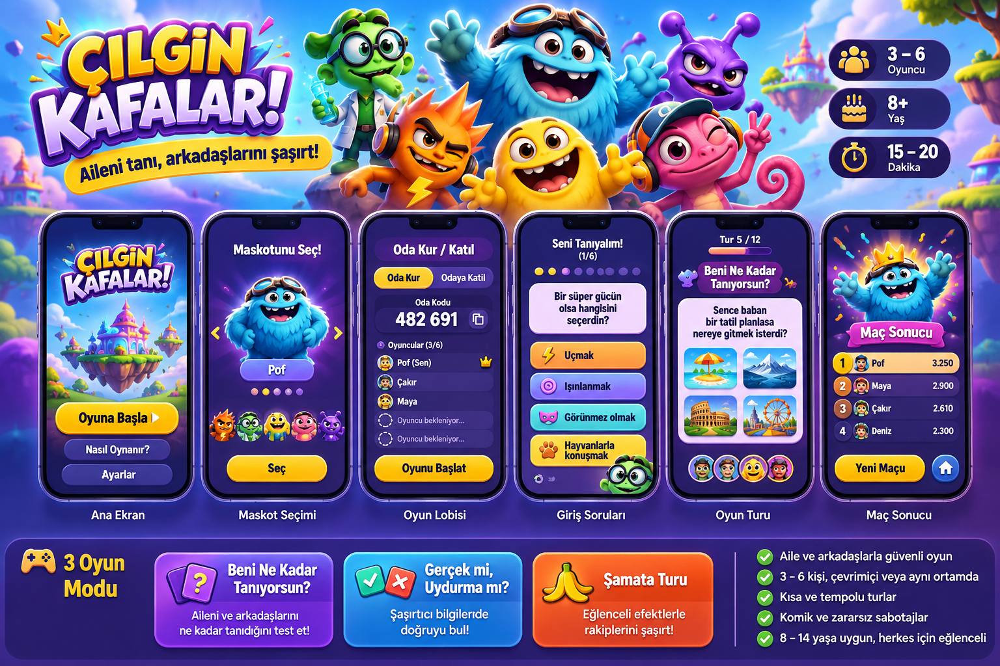

# ÇILGIN KAFALAR! — Mobil Aile & Arkadaş Parti Oyunu

> **Ürün, sanat yönetimi, oyun tasarımı ve yazılım geliştirme şartnamesi**  
> **Sürüm:** 1.0 — Konsept / MVP spesifikasyonu  
> **Tarih:** 7 Kasım 2026  
> **Durum:** Uygulama öncesi tasarım dokümanı; oynanabilir sürüm veya canlı sunucu değildir.  
> **Ürün adı:** ÇILGIN KAFALAR! (çalışma adı; marka, alan adı ve mağaza uygunluğu doğrulanmadı)



**Görselin statüsü:** Yapay zekâ ile üretilmiş **sanat yönetimi referansı**. Gerçek uygulama ekran görüntüsü, kodlanmış UI veya doğrudan oyuna aktarılabilir sprite seti değildir. Metin, hizalama ve oranlar geliştirme sırasında yeniden tasarlanıp kontrol edilir. Görselde görünen maskotlar aşağıdaki karakter spesifikasyonlarında netleştirilir.

---

## 0. Yönetici özeti ve değişmez ürün kararları

| Alan | Karar |
|---|---|
| Ürün | Aile ve arkadaşların kendi telefonlarından oynadığı, gerçek zamanlı mobil parti oyunu |
| Hedef kullanıcı | 8–14 yaş çocuklar **ve** birlikte oynayan aile üyeleri |
| Oyuncu sayısı | **En az 3, en fazla 6**; oda sahibi de oyuncudur |
| Platform | **Android ve iOS**; portre yönü, telefon odaklı |
| Bağlantı | İnternet üzerinden özel oda kodu, aynı Wi-Fi zorunlu değil |
| Maç | 12 tur, hedef 15–20 dakika |
| Mod karması | 5 × Beni Ne Kadar Tanıyorsun? + 4 × Gerçek mi Uydurma mı? + 3 × Şamata |
| Giriş | Her oyuncu her maç öncesinde **6 eğlenceli, zararsız tercih sorusunu** yanıtlar |
| Oyun dünyası | Canlı renklerde, özgün 3D hissi veren 2D maskotlar; fantastik macera adaları |
| Güvenlik | Özel davetli odalar; açık sohbet, herkese açık profil, rastgele eşleşme yok |
| Teknik yön | Flutter mobil istemci + gerçek zamanlı sunucu (Colyseus/Node.js), PostgreSQL yalnızca ihtiyaç duyulan kalıcı veri için |
| Barındırma | Mevcut Hostinger/Coolify altyapısı **uygunluk ve kaynak kontrolünden sonra** değerlendirilebilir; yetişkin oyunundan veri/servis sınırları ayrı |
| Ticari strateji | Önce kontrollü aile testi, ardından mağazalar; çocuklara yönelik satın alma/reklam modeli ayrıca değerlendirilir |

### Temel oyun vaadi

**“Aileni tanı, arkadaşlarını şaşırt!”** Oyun; yaşa uygun şaşırtıcı bilgiler, küçük komik sürprizler ve oyuncuların kendileri hakkında önceden verdiği cevapları tahmin etme üzerine kurulur. Hedef: Tek bir maç içinde hem çocukların hem yetişkinlerin adil şekilde puan kazanabilmesi ve birlikte eğlenmesi.

### MVP'ye girmeyenler

Açık metin/sesli sohbet, dışarıdan fotoğraf veya çizim paylaşma, kullanıcıların kendi sorularını kamuya açık yayımlaması, herkese açık arkadaş listesi, rastgele eşleşme, konum özellikleri, çocuk davranışına dayalı reklam hedeflemesi, loot box, sınırsız satın alma, gerçek para ödülü ve yetişkin oyununun içerik havuzuna erişim.

---

## 1. Marka, görsel ton ve sanat yönetimi

### 1.1 Marka kişiliği

- **Neşeli:** Her ekranda merak ve mizah; korkutucu veya küçümseyici dil yok.
- **Akıllı ama erişilebilir:** Çocukları küçük gören bir bebek oyunu değil; 11–14 yaş için de havalı.
- **Rekabetçi ama nazik:** Yenilgi komik ve yumuşak; puan kaybı üzerinden utandırma yok.
- **Fantastik ve özgün:** İnsan fotoğrafı veya hazır emoji/avatar yerine oyun evrenine özel maskotlar.
- **Aile dostu:** Evde, doğum gününde, akraba buluşmasında, arkadaş ortamında oynanabilir.

### 1.2 Renk sistemi

| Token | HEX | Kullanım |
|---|---|---|
| `navy-900` | `#231A57` | Koyu mor gece arka planı ve kontrast zemin |
| `violet-700` | `#5338B7` | Kartlar, ikincil yüzeyler |
| `violet-500` | `#825AE6` | Seçili durum ve oyun göstergesi |
| `sky-400` | `#44C9F8` | Bilgi kartları, eğlenceli yüzeyler |
| `aqua-400` | `#35D9C9` | Doğru, yardımcı bilgi |
| `sun-400` | `#FFD343` | Ana CTA ve ödül |
| `orange-500` | `#FF9330` | Şamata, hareketli vurgular |
| `pink-400` | `#F57FCE` | Sosyal/tanıma turları |
| `paper-100` | `#FFF8FF` | Soru yüzeyi |
| `ink-900` | `#20173D` | Açık zemin üzerindeki metin |
| `error-500` | `#D94962` | Hata, erişilebilir ikon + metinle desteklenir |

**Renk erişilebilirliği:** Sarı CTA üzerindeki yazı koyu mor/siyaha yakın olur. Sadece renk farkıyla doğru/yanlış belirtmeyin; işaret ve metin de gösterin. Kontrast ölçümü gerçek geliştirme sırasında WCAG AA seviyesine göre yapılır.

### 1.3 Tipografi

- **Başlık:** Yuvarlatılmış, kalın sans-serif; Türkçe `Ç, Ğ, İ, ı, Ö, Ş, Ü` desteği zorunlu. Örnek aday: Nunito Sans ExtraBold (lisans kontrolüyle).
- **Gövde:** Temiz, açık ve okunur sans-serif; örnek aday: Nunito Sans / Inter; oyun paketine kullanılacak fontun lisansı ve dosyaları ayrıca alınır.
- **Tipografi skalası:** H1 30–36 sp; ekran başlığı 24–28 sp; soru 21–25 sp; yanıt 16–20 sp; buton 18–20 sp; açıklama en az 14 sp.
- **Kural:** Soru metni bir görselin içine gömülmez; Flutter'da dinamik erişilebilir metindir.

### 1.4 Şekil ve yüzeyler

- Temel kart yarıçapı: **20–24 dp**; büyük CTA: **22–28 dp**.
- Kartlar kalın dış gölge yerine hafif derinlik, yumuşak parlama ve 2–3 px kenar vurgusuyla ayrılır.
- Tüm etkileşimli hedefler en az **48 × 48 dp**; asıl cevap alanları 56–70 dp yüksekliğe çıkarılır.
- Gövdeyi yoğun konfeti/parıltı kaplamaz; görsel efektler oynanışı kapatmaz.
- Durum ikonları özel çizim varlıklarıdır; emoji nihai karakter/ikon olarak kullanılmaz.

### 1.5 Ses ve hareket

| Olay | Görsel tepki | Ses/haptik |
|---|---|---|
| Dokunma | 110 ms hafif basılma (`scale 0.96`) | Çok hafif dokunma |
| Odaya katılım | Maskot kartı sahneye kayar (350 ms) | Kısa ‘pop’ |
| Cevap gönderme | Kart çevresi vurgulanır, kilitlenir | Tek dokunma |
| Doğru cevap | Yıldız yayılımı, +puan (500 ms) | Pozitif kısa jingle |
| Yanlış cevap | Kart hafif sallanır, sonra sabitlenir | Sert/utandırıcı ses yok |
| Şamata | Eğlenceli parçacık 0.5–1.2 sn | Kapatılabilir efekt |
| Final | Kürsü ve maskot zafer pozu (2.0 sn) | Kapatılabilir fanfar |

**Azaltılmış hareket** sistem ayarına uyulur; animasyonlar atlanabilir. Ses kapatma her zaman erişilebilir olmalıdır. Parlama/flaş animasyonlarında nöbet riskini artırabilecek hızlı yanıp sönmeler kullanılmaz.

---

## 2. Altı özgün maskot — karakter tasarım dosyası

**Ortak biçim:** Gerçek kişi benzeri olmayan, renkli fantastik yaratıklar. Kafa/gövde oranı 1.2–1.6:1; büyük okunur gözler, farklı silüet, farklı palet. Her karakter portre/mini ikon olarak 56 px'e küçüldüğünde de ayırt edilebilmeli.

### 2.1 Pof — mavi, tüylü ana maskot

- **Rol:** Oyunun yüzü, öğretici rehber ve ana menü kahramanı.
- **Silüet:** Tombul yuvarlak gövde, iri tüylü kollar, tepesinde pilot gözlüğü, kısa bacaklar.
- **Renk:** Buz mavisi `#42BCEC`, koyu mavi gölge `#2167B9`, sıcak krem dişler.
- **Kişilik:** İyi niyetli, heyecanlı, hafif sakar; asla alaycı değil.
- **İmza hareketi:** Zıplayıp iki kolunu kaldırma; doğru cevapta küçük yıldız salma.
- **İfadeler:** Sevinç / merak / şaşkınlık / düşünme / minik hayal kırıklığı / zafer.
- **Kullanım:** Splash, onboarding, uygulama ikonu için birincil aday, maç sonucu.

### 2.2 Çakır — turuncu kıvılcım

- **Silüet:** Saç/tepe kısmında üç yumuşak alev/kıvılcım çıkıntısı; ince kollar; enerji çizgileri.
- **Renk:** Turuncu `#FF8A2C`, sarı `#FFCB2B`, mor kenar gölge.
- **Kişilik:** Aceleci, sportif, sabırsız ama yardımsever.
- **İmza hareketi:** Yerinde yıldırım gibi hızlı dönüp gülümser.
- **Kullanım:** Şamata turu, hızlı seçim anları, puan bonusları.

### 2.3 Minti — yeşil mucit

- **Silüet:** İri yuvarlak gözlük, saç yerine iki yuvarlak yaprak tutamı, küçük laboratuvar çantası.
- **Renk:** Nane yeşili `#62D65B`, koyu yeşil `#278A57`, camgöbeği yardımcı detaylar.
- **Kişilik:** Meraklı, keşfetmeyi seven, komik icatlar yapan karakter.
- **İmza hareketi:** Minik büyüteç çıkarır, başarılı olunca ampul belirir.
- **Kullanım:** Gerçek mi Uydurma mı, bilgi açıklamaları.

### 2.4 Bıdık — sarı, şekil değiştiren jöle

- **Silüet:** Fasulye/armut biçimli, tek parça yumuşak gövde, kısa kollar, büyük yanaklar.
- **Renk:** Altın sarısı `#FFD94A`, turuncu gölge `#F1A72C`.
- **Kişilik:** Her şeye heyecanlanan, zararsız komikliklerin ustası.
- **İmza hareketi:** Sevinince yay gibi uzayıp eski haline döner.
- **Kullanım:** Kutlama, bonus, öğretici mini bildirimler.

### 2.5 Pika — pembe bukalemun

- **Silüet:** Uzun kıvrık kuyruk, büyük tek taraflı göz ifadesi, renkli kulaklık, şapka.
- **Renk:** Pembe `#F777BA`, mercan `#FF8C8A`, parlak camgöbeği.
- **Kişilik:** Sosyal, neşeli, arkadaşlarını en iyi tanıyan maskot.
- **İmza hareketi:** Kuyruğuyla yıldız çizer, göz kırpar.
- **Kullanım:** Beni Ne Kadar Tanıyorsun?, giriş soruları.

### 2.6 Zıpzıp — mor uzaylı

- **Silüet:** İki anten, ince yaylı bacaklar, fasulye/kapsül gövde.
- **Renk:** Mor `#9250DA`, lavanta `#B382FA`, turkuaz küçük detaylar.
- **Kişilik:** Akıllı, afacan, bazen şaşırtıcı kararlar verir.
- **İmza hareketi:** Antenleriyle ışıklı soru işaretleri üretir.
- **Kullanım:** Sürpriz olaylar, yanlış/doğru tahmin efektleri.

### 2.7 Üretim varlıkları

**Her maskot için zorunlu teslim:**

1. Ön, 3/4 ve yan görünüm; aynı model/renk/aksesuarla.
2. Tam boy şeffaf PNG/WebP (ör. 2048 × 2048 çalışma varlığı).
3. 512 × 512 karakter kartı, 256 × 256 ve 96 × 96 profil ikonu.
4. Altı yüz ifadesi (idle, happy, confused, surprised, thinking, victory).
5. Idle (2–3 sn loop), select (0.6 sn), celebrate (1.2 sn), lose-soft (0.8 sn), shenanigan (1 sn) animasyonları.
6. Animasyon sprite sheet veya Rive varlığı; **kaynak dosyaları lisanslı/teslim edilebilir** formatta saklanır.
7. 56 px ekranda tanınabilirlik, farklı arka planlarda kontrast ve FPS testi.

**Not:** Bu dokümandaki referans kolajı ayrı animasyonlu varlıkları sağlamaz. Üretim sırasında sıfırdan model, rig veya sprite hazırlanır; telif/lisans kontrolü yapılır.

---

## 3. Mobil ekran sistemi (tam ekran spesifikasyonları)

### 3.1 Genel grid, cihaz adaptasyonu

- **Tasarım artboard'u:** 390 × 844 **logical pixel / dp**; hedef portre, 9:16'dan daha uzun ekranları da destekle.
- **Dış boşluk:** yatay 20 dp; küçük telefonda 16 dp; güvenli alanlar (`SafeArea`) uygulanır.
- **Bileşen aralığı:** 8 / 12 / 16 / 24 / 32 dp sistemi.
- **Ana CTA:** 100% kullanılabilir genişlik, 58–64 dp yükseklik; alt güvenli alandan önce 16–24 dp boşluk.
- **Alt navigasyon:** Sadece ana menüde; gerçek maç sırasında kaldırılır.
- **Düşük ekranlarda:** Dikey kaydırma yalnızca menü/lobi/onboarding içeriklerinde; süreli cevap ekranlarında soru ve tüm seçenekler görünür kalmalı.
- **Tablet:** Merkezi maks. 520–600 dp içerik sütunu; sağ/sol görsel boşluklar.
- **Erişilebilirlik:** metin ölçekleme, VoiceOver/TalkBack, buton etiketleri, renk körlüğü dostu durumlar.

### 3.2 Ekran S01 — Splash / açılış

**İşlev:** Marka tanıtımı, varlık yüklemesi, bağlantı/hizmet sürümü kontrolü.

**Yerleşim:** Üstte parlak gökyüzü/adalardan oluşan dekor; orta bölümde 3D hissi veren `ÇILGIN KAFALAR!` logo, Pof ön planda; altta kısa yükleme göstergesi ve sürüm bilgisi. Yükleme uzarsa erişilebilir “Bağlantı kontrol ediliyor” mesajı.

**Etkinlik:** İlk açılışta servis durumunu kontrol eder; hatada tekrar dene + çevrimdışı bilgilendirme. Kullanıcıyı bekleme döngüsüne sokmaz.

### 3.3 Ekran S02 — Ana menü

**İşlev:** Oda kur, odaya katıl, nasıl oynanır, ayarlar.

| Bölge | Yükseklik / davranış |
|---|---|
| Üst şerit | 56–64 dp; logo küçük; ses/ayar ikonu sağda |
| Kahraman alanı | Yaklaşık 230–300 dp; Pof + fantastik ada, hafif idle animasyonu |
| Başlık/slogan | Başlık 30–36 sp; slogan 16–18 sp |
| Ana CTA | `ODA KUR` 60 dp, sarı |
| İkincil CTA | `ODAYA KATIL` 56 dp, mor |
| Alt işlemler | `NASIL OYNANIR?`, `AYARLAR`, `GİZLİLİK` |

**Durumlar:** Online / bakım / bağlantı yok; hata mesajları çocuk dostu ve eyleme dönük. “Oyuna Başla” butonu alternatif akış olarak önce `Oda Kur / Katıl` seçim ekranına gidebilir; MVP'de doğrudan iki büyük CTA daha az adımdır.

### 3.4 Ekran S03 — Maskot seçimi

**Yerleşim:** Üstte `Maskotunu Seç`; ortada seçilen karakterin büyük 3/4 pozu (220–300 dp); altında isim, 1 satır kişilik, alt yatay altı küçük portre; dipte `SEÇ` CTA.

**Davranış:** Bir porta dokununca büyük figür 300–450 ms geçiş animasyonu yapar. Aynı maskotu farklı oyuncular da seçebilir; karakter tekil kilitleme yok. Kullanıcı seçimini maç boyunca değiştiremez, ancak yeni maçta değiştirebilir. İlk sürümde bütün karakterler eşit güçte, kozmetiktir.

**Boş/başarısız yükleme:** Varlık yüklenemezse özel çizilmiş basit 2D silüet göster; emoji kullanma.

### 3.5 Ekran S04 — Oda oluşturma / katılım

**Oda kur:** Tek eylemle sunucudan altı karakterli, karışması zor kod üretir (örn. `482691` **temsili**, üretimde tahmin/rate limit uygulanır). Oda sahibi otomatik oyuncu olur.

**Odaya katıl:** Kod alanı (6 rakam/harf tercihi sunucu protokolüyle sabitlenir), 2–16 karakter takma ad, `KATIL`. Başarılıysa maskot seçim/lobi akışı. Yanlış kod, dolu oda, maç başlamış, süre dolmuş gibi durumlarda ayrı mesaj.

**Not:** Gerçek isim/telefon/e-posta zorunlu değil; takma ad filtrelenir ve gerektiğinde rastgele öneri sunulur.

### 3.6 Ekran S05 — Lobi

**Yerleşim:**

- Üst başlık: `OYUN LOBİSİ`; yanındaki oda kodu büyük ve kopyalanabilir.
- Kod paylaşımı: platform paylaşım menüsüne davet linki (yalnızca özel oda).
- Orta alan: 2 sütun × maksimum 3 satır, altı oyuncu kartı, her kartta maskot portresi, takma ad, `Hazır` rozeti.
- Alt alan: `HAZIRIM` (her oyuncu), oda sahibi için `OYUNU BAŞLAT`.
- Başlat koşulu: **3–6 oyuncu**, hepsi hazır; eksikse açıklama. Oda sahibi ayrılırsa sunucu güvenli lider devri yapar.

**Gizlilik:** Oda yalnızca kod veya davet linkiyle; listeleme ve genel keşif yok. Oda kodunu sonsuza dek kullanmayın, oda ömrü sınırlandırılır.

### 3.7 Ekran S06 — Giriş: Seni Tanıyalım! (6 soru)

**Amaç:** Her oyuncunun cevaplarından maç içi “arkadaşını tanı” soruları üretmek.

**Yerleşim:** Üstte `Seni Tanıyalım!` + `1/6`, 6 adımlı nokta/ilerleme çubuğu; büyük beyaz soru kartı; 4 farklı renkli, 56–64 dp cevap kartı; alt `Geri` ve `Devam`; köşede Pika maskotu.

**İçerik kuralları:** Sağlık, aile içi çatışma, gelir, adres, okul adı, tam doğum tarihi, şifre, aşk/cinsellik veya mahrem bilgi sorulmaz. Sorular kurgu, hobiler, hayali güçler ve zararsız tercihler üzerine kurulur. Kişisel soruyu değiştirme hakkı vardır; birden çok seçenekten seçim yapılabilir; serbest metin yok.

**Altı örnek:**

| ID | Soru | Seçenekler |
|---|---|---|
| `PREF_SUPERPOWER` | Bir süper gücün olsa hangisini seçerdin? | Uçmak / Işınlanmak / Görünmez olmak / Hayvanlarla konuşmak |
| `PREF_PET` | Hayali takım arkadaşın hangi hayvan olsun? | Panda / Ejderha / Penguen / Tilki |
| `PREF_TRAVEL` | Bir günlük maceraya nereye giderdin? | Uzay / Dinozor çağı / Deniz altı / Şeker gezegeni |
| `PREF_SKILL` | Hangi oyun türünde kendine güveniyorsun? | Bulmaca / Hız / Hafıza / Tahmin |
| `PREF_ROBOT` | Bir robot arkadaşın olsa ne yapsın? | Oyun oynasın / Yemek yapsın / Uçursun / Şaka yapsın |
| `PREF_BASE` | Hayali gizli üssün nerede olsun? | Ağaç ev / Uzay istasyonu / Denizaltı / Bulut şatosu |

**Veri:** `playerId + questionId + selectedOptionId`; oda bazında kısa ömürlü tutulur. Oyuncular diğerlerinin cevaplarını oyun turuna kadar göremez. Cevaplar maç sonunda TTL ile silinir veya izinli anonim analitik dışındaki her yerden kaldırılır. Minimum veri ilkesi.

### 3.8 Ekran S07 — Tur yükleniyor / tanıtım

**Yerleşim:** Tam ekran kategori afişi 1.5–2.5 sn; örneğin Pika bir soru balonu taşır; `BENİ NE KADAR TANIYORSUN?` veya Minti `GERÇEK Mİ UYDURMA MI?`.

**Davranış:** Sunucu tur başlangıç zamanını belirler; animasyon bitse de istemci tek başına tur başlatmaz. Tekrar bağlananlar varsa mevcut faza doğrudan gider.

### 3.9 Ekran S08 — Beni Ne Kadar Tanıyorsun? turu

**Soru örneği:** `Maya bir süper güç seçse hangisini seçerdi?`

**Yerleşim:** Üstte `Tur 5/12`, görsel sayaç (20 sn), sorunun sahibi maskot portresi; merkezde soru kartı; altında 2×2 cevap kartı; dipte `Cevabın kilitlendi` durumu.

**Kural:** Hedef oyuncunun daha önce verdiği cevap sunucuda tutulur, hedef oyuncu **kendi sorusunda tahmin yapmaz**. Hedef oyuncu ekranda “Arkadaşların seni tahmin ediyor” animasyonu görür. Diğer 2–5 oyuncu tek cevap verir. En az 3 kişiyle de çalışır.

**Puan:** Doğru tahmin `120 puan`; hız bonusu maksimum `30`; soru sahibi en az yarıdan fazla tahminci doğru bildiyse `30` puan alır. Bir oyuncunun arka arkaya sürekli hedef olmaması için adil dağıtım uygulanır.

**Adalet:** 5 tanıma turu 6 oyuncunun tamamına soru garantisi vermez; farklı maçlarda veya mümkün olduğunda sırayla seçim yapılır. Eğer oyun sahibi/maskotu bilgisi okunmuyor ise puan dağılımı değil görsel açıklama güçlendirilir.

### 3.10 Ekran S09 — Gerçek mi Uydurma mı?

**Yerleşim:** Minti maskotu + büyük gerçek/uydurma kartı, iki büyük yanıt; tercihe göre açıklama görseli. Süre 15–20 sn; açıklama ekranı 4–6 sn.

**Örnek:** `Ahtapotların üç kalbi vardır.` → **Gerçek**. Yanıt sonrası anlaşılır kısa açıklama gösterilir.

**Kural:** Sorular editör doğrulamasından geçer; kaynak alanı yönetim panelinde tutulur. Muğlak, tartışmalı veya hızla değişen sorular ilk havuza alınmaz. Doğru cevap `100`, hız bonusu maksimum `40`.

### 3.11 Ekran S10 — Şamata Turu

**Amaç:** Arkadaşları eğlendiren küçük beklenmedik efektler; gerçek cezalandırma değil.

**İlk üç etki:**

1. **Baloncuk Yağmuru:** Cevap kartlarının çevresinde balonlar uçar; **cevap metinlerini kapatmaz**.
2. **Muz Kabuğu:** Rakibin maskotu komik şekilde kayar; cevap süresi, buton basma alanı veya puanı bozulmaz.
3. **Renkli Konfeti:** Soru başlamadan kısa konfeti yağar; yanıt seçenekleri sabit kalır.

**İşlevsel Şamata:** 3 Şamata turunda tüm oyunculara kısa dikkat/hafıza sorusu gösterilir; en iyi cevaplayan puan alır. Rakibe gönderilen kozmetik efekt oyunun adaletini bozmaz. İlk MVP'de rastgele **en fazla 1 etki/tur/oyuncu**. Hedef oyuncu rahatsız edici efektleri erişilebilirlik ayarından kapatabilir.

**Şamata puanı:** Doğru `100`, hızlı `0–30`; kozmetik efekt puan kazandırmaz ve kaybettirmez.

### 3.12 Ekran S11 — Tur sonucu

**Yerleşim:** Üstte doğru cevap, altında kısa açıklama, orta 6 oyunculuk canlı puan listesi, altta sonraki tura kalan süre. Her oyuncunun kazandığı tur puanı yanında `+120` gibi görünür.

**Davranış:** Sonuçlar sunucudan gelmeden gösterilmez. Sessiz animasyon alternatifi. Sıralama eşitliğinde tur süreleri tutarlı ikincil anahtar olarak kullanılabilir ama final adalet kuralı ayrıca tanımlanır.

### 3.13 Ekran S12 — Final

**Yerleşim:** İlk üç oyuncu için maskotlu kürsü, kazanan için yıldız ve konfeti; altında kalan oyuncular, puanlar ve eğlenceli rozetler: `En İyi Tahminci`, `Bilgi Kaşifi`, `Şamata Ustası`.

**CTA:** `YENİ MAÇ` + `ANA MENÜ`; aynı grupla yeni maç için yeni 6 tercihin zorunluluğu ürün ayarına bağlıdır. MVP'de **yeni maçta altı cevap yeniden alınır**, seçenekler karıştırılabilir.

**Eşitlik:** Aynı puan alanlar aynı sıra olarak gösterilir; zorunlu ekstra süreli soru yok. Kazanan künyesinde “Berabere” ekranda açık görünür.

### 3.14 Ekran S13 — Ayarlar / ebeveyn bilgileri

Ses / müzik / hareket azalt / metin boyutu / nasıl oynanır / gizlilik bildirimi / çocuk verileri / destek. Dış bağlantı, satın alma ve ebeveyn onayı gerektiren işlemler uygun **ebeveyn kapısı** ve platform kurallarıyla korunur; ebeveyn kapısı tek başına tüm yasal gereklilikleri karşılamaz.

---

## 4. Oyun tur yapısı ve puan tasarımı

### 4.1 12 turluk karşılaşma

| Faz | Süre hedefi | Sunucu otoritesi |
|---|---|---|
| Lobi + hazır olma | Oyuncuya bağlı | Oda kapasitesi, kilitleme |
| Altı giriş sorusu | 1–3 dk | Tüm cevapların tamamlanması |
| Tur tanıtımı | 2 sn | Faz `INTRO` |
| Soru/tahmin | 15–20 sn | Cevaplar ve `endsAt` |
| Sonuç | 5 sn | Doğru cevap, puan, sıralama |
| 12 tur sonu | 10–20 sn | Final skorları |

**Sıralama:** Sunucu 5 tanıma + 4 gerçek/uydurma + 3 şamata turunu adil karıştırır. İlk tur kolay olmalı, son 2 tur daha heyecanlı olabilir ancak ani, açıklanmamış ×3 puan gibi dengesizlik yok.

### 4.2 Puan matematiği

- Tanıma: `120 + floor(30 × remainingSeconds / allottedSeconds)`, yalnızca doğru cevapta.
- Gerçek/Uydurma: `100 + floor(40 × remainingSeconds / allottedSeconds)`, yalnızca doğru cevapta.
- Şamata dikkat sorusu: `100 + floor(30 × remainingSeconds / allottedSeconds)`, yalnızca doğru cevapta.
- Tanıma sorusunun sahibi: Tahmincilerin **yarıdan fazlası** doğruysa `+30`.
- Yanlış/geç cevap `0`; negatif puan yok.
- **Önemli:** Soru sahibi tahminci olmadığı için kaçırdığı puanı dengelemek amacıyla tasarımda tur sonunda maksimum toplam puanlar simülasyonla kontrol edilmeli. Beta sırasında gerekirse ödül katsayıları değiştirilebilir.

### 4.3 Oda kuralları

- Aynı anda **3–6** oyuncu.
- Oda sahibi ayrılırsa uygun oyuncuya lider devri.
- Maç başladıktan sonra **yeni oyuncu katılımı kapalı**; kısa süreli kopan mevcut oyuncu güvenli reconnect token ile geri döner.
- İlk geçerli cevap esas; tekrar gönderilen cevap yok sayılır.
- Sunucu saati otoriterdir; cihaz süresi puan hesaplamaz.
- Çok sayıda bağlantı/oda denemesine IP ve anonim oturum düzeyinde hız sınırı.
- Bir oyuncu maç ortasında kesin ayrılırsa maç devamı için: minimum 3 aktif oyuncu kaldıysa kalanlarla devam, aksi durumda adil şekilde sonlandır/yeniden başlat önerisi.

---

## 5. Çocuk güvenliği, etik ve gizlilik tasarımı

> **Uyarı:** Hukuki uyumun tamamlandığı iddia edilmez. Hedef pazarların çocuk verisi ve mağaza politikaları, yayından önce uzman incelemesinden geçmelidir.

1. **Yalnızca özel odalar:** Kamusal oda dizini, dış kullanıcı araması ve rastgele eşleştirme yok.
2. **Açık sohbet yok:** Serbest metin, özel mesaj, fotoğraf/video/ses yükleme yok.
3. **Minimum kimlik bilgisi:** Takma ad + geçici oda kimliği; çocuklardan doğum tarihi, okul, adres, telefon, e-posta veya tam ad istenmez.
4. **Veri ayrımı:** Yetişkin oyunu FİTNE! ile ayrı veritabanı, ayrı kullanıcı kimliği ve ayrı içerik havuzu. Ayrı sunucu projesi/namespace önerilir.
5. **Kısa saklama:** Oyun öncesi tercih cevapları varsayılan olarak maç/oda ömrü sonunda silinir; servis günlüklerinde bu cevaplar tutulmaz.
6. **Oda güvenliği:** Yüksek entropili geçici oda kodu, sınırlı deneme, kısa TTL, bağlantı başına sınır, gerektiğinde oda sahibi oyuncu çıkarabilir.
7. **Uygunsuz isim filtresi:** Takma adlar ve davet metinleri temel moderasyon/karakter filtresinden geçer; kullanıcı müdahalesi için kolay rapor/ayrılma yolu.
8. **Kontrol edilebilir efektler:** Ses, titreşim, hareket ve parlama kapatma; ekran sallama yok.
9. **Mağaza ve mevzuat:** Türkiye KVKK, ilgili ülke çocuk gizliliği düzenlemeleri; ABD hedeflenirse COPPA; App Store Kids Category / yaş derecelendirmesi ve Google Play Families uygunluğu hedeflenen sınıflandırmaya göre değerlendirilir.
10. **Ücretlendirme:** İlk MVP'de satın alma yok; sonradan eklenecekse ebeveyn kontrolü, yaşa uygun reklam/satın alma kısıtları ve açık ticari etiketleme zorunlu tasarım girdisidir.
11. **Yüz yüze oyun güvenliği:** Yetişkinin katılımı teşvik edilebilir; ebeveyn gözetimi varmış gibi otomatik bir güvence iddia edilmez.
12. **İçerik denetimi:** Sorular korku, zorbalık, mahrem itiraf, dışlayıcı sosyal sıralama veya küçük düşürücü mizah içermez.

### Yaşa göre erişilebilirlik

- **8–10:** Kısa ve kolay dil, basit animasyon, görsel destek, daha uzun cevap süresi opsiyonu.
- **11–14:** Daha zor gerçek/uydurma soruları, daha hızlı animasyon tercihleri, farklı içerik havuzu.
- Yaş bilgisi toplamak yerine oda oluşturucunun `Macera` / `Efsane` zorluk tercihiyle ilerlenebilir. Bunun tek başına yasal yaş doğrulaması olmadığı açık olmalıdır.

---

## 6. Teknik uygulama mimarisi

### 6.1 Önerilen yapı

```text
cilgin-kafalar/
├── apps/
│   ├── mobile/                 # Flutter, Android + iOS
│   └── admin/                  # Soru moderasyon paneli (MVP sonrası / minimal)
├── services/
│   ├── game-server/            # Node.js + TypeScript + Colyseus
│   └── api/                    # İhtiyaç oluşursa REST API
├── packages/
│   ├── question-schema/        # JSON schema / soru seed verisi
│   └── protocols/              # Mesaj sözleşmesi ve sürümleme
├── assets/
│   ├── mascots/
│   ├── backgrounds/
│   ├── effects/
│   ├── ui/
│   └── sounds/
├── infrastructure/
│   ├── docker/
│   └── coolify/
├── docs/
│   ├── product.md
│   ├── ui-spec.md
│   ├── safety.md
│   └── test-plan.md
└── README.md
```

**Kritik ayrım:** Sunucu motorundan öğrenilen ortak kod yeniden kullanılabilir ancak çocuk oyununun canlı veri alanı, logları ve yönetsel erişimi yetişkin oyunundan ayrılır. İki uygulama aynı marka/uygulama değil.

### 6.2 Sunucu durum makinesi

```text
CREATED
  ↓ join / ready (3–6 oyuncu)
LOBBY
  ↓ host start
PREFERENCES (her oyuncu 6 cevap)
  ↓ tüm geçerli cevaplar alındı
ROUND_INTRO → ROUND_OPEN → ROUND_REVEAL
     ↑                          ↓
     └──────────── next round ──┘ (12 kez)
  ↓
FINAL → REMATCH_LOBBY → PREFERENCES
```

**Sunucu olayları** (MVP başlangıç sözleşmesi):

| Olay | Yön | Veri / açıklama |
|---|---|---|
| `room:create` | Client → Server | `nickname`, `mascotId` |
| `room:join` | Client → Server | `code`, `nickname`, `mascotId` |
| `lobby:state` | Server → Clients | Takma ad, maskot, hazır bilgisi, oyuncu sayısı |
| `player:ready` | Client → Server | `ready: boolean` |
| `match:start` | Host → Server | Sunucu tüm koşulları kontrol eder |
| `preferences:answer` | Client → Server | `questionId`, `optionId`; diğerlerine yayınlanmaz |
| `preferences:progress` | Server → Clients | Sadece tamamlanma sayıları |
| `round:intro` | Server → Clients | Tur tipi, tur numarası |
| `round:question` | Server → Clients | Soru, seçenekler, süre sonu; **correctOptionId içermez** |
| `round:answer` | Client → Server | `roundId`, `optionId` |
| `round:locked` | Server → Client | Kullanıcının cevabı alındı |
| `round:result` | Server → Clients | Doğru yanıt, puanlar, açıklama |
| `match:final` | Server → Clients | Sıralama, rozetler |
| `player:reconnected` | Server → Client | Güncel faz, kalan süre |

**Gerçek Colyseus API uygulaması:** Üstteki olay isimleri bir *tasarım protokolüdür*, doğrudan mevcut Colyseus kodu oldukları iddia edilmez. Oda oluşturma/katılma Colyseus matchmaker istemci çağrılarıyla eşleştirilecek.

### 6.3 Soru modeli örneği

```json
{
  "id": "PREF_SUPERPOWER",
  "kind": "preference",
  "difficulty": "all",
  "prompt": "Bir süper gücün olsa hangisini seçerdin?",
  "options": [
    { "id": "fly", "label": "Uçmak" },
    { "id": "teleport", "label": "Işınlanmak" },
    { "id": "invisible", "label": "Görünmez olmak" },
    { "id": "animals", "label": "Hayvanlarla konuşmak" }
  ],
  "correctOptionId": null,
  "tags": ["family", "imagination"],
  "locale": "tr-TR"
}
```

**Gerçek/Uydurma içeriğinde** kaynak URL'si, editör onayı ve son gözden geçirme tarihi ek alan olarak saklanır.

### 6.4 Çocuk verileri için teknik ilkeler

- Geçici oyuncu kimlikleri ve kısa ömürlü reconnect token.
- Gizli tercih cevapları istemcilere toplu gönderilmez; yalnızca ilgili soru sonuçlandığında gösterilir.
- IP adresleri, tam kullanıcı ajanı veya oturum verileri mümkün olduğunca kısa süre ve operasyonel zorunluluk çerçevesinde işlenir; erişim logları ayrıca gözden geçirilir.
- Üretim/deneme ortamlarının sırları, DB erişimleri ve logları ayrı.
- WebSocket üzerinde TLS (`wss://`), mesaj şeması doğrulaması, hız sınırı, yetkili host kontrolü.
- Database gerekli değilse tercih/oda bilgisi yalnızca sunucu belleğinde TTL ile saklanabilir; MVP'de kalıcı çocuk profili üretmeyin.

### 6.5 Barındırma ve alan adı

Mevcut **Hostinger VPS/Coolify** ortamı kaynak tüketimi ve erişim durumuna göre değerlendirilebilir. Ayrı proje ve servisler önerilir. `normellestir.me` alan adının çocuk oyunu için kullanımı marka/ürün konumlandırmasına göre ayrıca kararlaştırılır; bu dokümanda alan adı satın alındığı veya DNS yapılandırıldığı iddia edilmez.

**Örnek, rezerve edilmemiş subdomainler:** `kids-game.normellestir.me` (multiplayer), `kids-staging.normellestir.me` (test), `kids-admin.normellestir.me` (korumalı panel). Bunlar yalnızca öneridir.

Önerilen Coolify servisleri: `ck-game-prod`, `ck-game-staging`, gerekirse `ck-db-prod`/`ck-db-staging`, sınırlı admin panel. Production ve staging farklı environment ve secret setleri kullanır. Erişim için Traefik HTTPS/WSS. Veritabanı dışarıya açılmaz. Sunucu dışı şifreli yedekler ve periyodik geri yükleme testi gereklidir.

---

## 7. Oynanabilir ilk prototip: kesin MVP kapsamı

**Aşama A — Oda motoru (ilk teknik kilometre taşı)**

- İki farklı telefondan test edilebilen özel oda kurma/katılma.
- Oyuncu sayısı 3–6; oyuncular birbirini gerçek zamanlı görür.
- Maskot seçimi, hazır durumu, oda koduyla davet.
- Ağ kopunca yeniden bağlanma ve oda sahibi devri.

**Aşama B — Gizli tercihler**

- Altı cevap, her oyuncu için ayrı ve gizli toplanır.
- Herkes tamamlamadan maç açılmaz.
- Cevaplar diğer cihazlara açıklanmaz.

**Aşama C — 12 turluk sunucu tabanlı maç**

- 5 tanıma / 4 bilgi / 3 şamata turu.
- Sunucu süresi, cevap kilitleme, doğru cevap, puan, sonuç.
- Oyuncu başına hedef soru dağılımı ve maç sonu final.

**Aşama D — Görsel ve ses entegrasyonu**

- Maskot 2D animasyonları, geçişler, sonuç görselleri.
- Ses/haptik ve hareket azalt ayarları.
- Küçük ve büyük telefonlarda okunurluk.

**Aşama E — Kapalı aile testi**

- 3, 4, 5, 6 oyunculu odalar; aynı ağ ve farklı ağ.
- En az üç ayrı aile/arkadaş grubu (örnek test hedefi).
- Test görevleri: 1 maç bitirme, tekrar maç açma, yanlış oda kodu, kopma/geri dönüş, erişilebilirlik.
- Doğrulanmış sonuçlar raporlanmadan mağaza yayınına geçilmez.

### Kabul kriterleri (test checklist)

- [ ] Android ve iOS cihazdan aynı odaya girilebiliyor.
- [ ] 2 kişiyle maç başlatılamıyor; 3–6 kişiyle başlatılabiliyor; 7'nci oyuncu reddediliyor.
- [ ] Altı giriş cevabı her oyuncu için ayrı ve gizli saklanıyor.
- [ ] Kişi kendi tanıma sorusunu cevaplamıyor.
- [ ] Soru cevapları süre dolmadan ifşa edilmiyor.
- [ ] 12 tur, doğru puanlar ve final sıralamasıyla tamamlanıyor.
- [ ] Bağlantı kopan oyuncu geçerli oturumuyla geri dönebiliyor.
- [ ] En az 3 oyuncu kaldığında maç sürüyor; 3'ün altına düşünce açık sonlandırma akışı var.
- [ ] Sabotaj/efekt kontrolleri soru metinlerini kapatmıyor.
- [ ] Görünür ekranlarda gerçek isim/e-posta/adres talep edilmiyor.
- [ ] Açık sohbet, yabancı eşleştirme ve kamusal profil bulunmuyor.
- [ ] Oda kodu tahminine hız sınırı ve takma ad filtresi mevcut.
- [ ] Türkçe karakterler ve ekran okuyucu etiketleri doğru.
- [ ] Düşük hareket/sessiz modlar çalışıyor.
- [ ] Uygulama aynı anda en az 6 gerçek bağlantıyla test edildi.

---

## 8. Tasarım ekibine teslim paketi ve dosya adlandırma

```text
art/
├── brand/
│   ├── logo_primary.svg
│   ├── logo_dark.svg
│   ├── app_icon_1024.png
│   └── color_tokens.json
├── mascots/
│   ├── pof/{turnaround,portrait,expressions,animations}/
│   ├── cakir/{turnaround,portrait,expressions,animations}/
│   ├── minti/{turnaround,portrait,expressions,animations}/
│   ├── bidik/{turnaround,portrait,expressions,animations}/
│   ├── pika/{turnaround,portrait,expressions,animations}/
│   └── zipzip/{turnaround,portrait,expressions,animations}/
├── backgrounds/{island,lobby,question,final}/
├── ui/{buttons,cards,icons,progress,states}/
├── sounds/{ui,correct,wrong,shamata,final}/
└── exports/{android,ios,marketing}/
```

**İsim kuralı:** ASCII dosya isimleri (`cakir`, `bidik`, `zipzip`), ekranda doğru Türkçe gösterim (`Çakır`, `Bıdık`, `Zıpzıp`). Her sprite'ın sürüm kodu ve lisans kaynağı tutulur.

### Üretim sırası

1. Altı maskotun tasarım kartları (eşit sanat dili).
2. Pof'un app icon + splash üretimi.
3. S02 ana menü, S03 maskot seçimi, S05 lobi yüksek çözünürlüklü tekil ekranları.
4. S06 altı soruluk giriş, S08/S09/S10 üç tur türü, S11/S12 sonuç ekranları.
5. Rive/sprite hareket setleri, sesler, düşük cihaz optimizasyonu.
6. Konsept görsellerden bağımsız, geliştirilebilir `Flutter Widget` component sistemi.

### Üretim kalite kapıları

- Altı maskot birbiriyle karışmıyor mu (silüet testi)?
- 360 × 780 dp cihazda tüm yanıtlar görünür mü?
- Soru arka planından ayrılıyor mu?
- Renk körlüğü ve ekran okuyucu ile cevap seçilebilir mi?
- Yanlış cevap alan çocuk aşağılanmış hissediyor mu? (kullanıcı testi)
- Bir maç boyunca animasyonların tekrarı yorucu oluyor mu?
- Görsel dosyaların toplam yükü düşük/orta segment cihazlarda kabul edilebilir mi?

---

## 9. İlk içerik bankası — örnekler

### Tanıma (tercihlerin oyun sorusuna dönüşümü)

**Giriş:** `Pika: Hayali gizli üssün nerede olsun?` → oyuncu `Uzay istasyonu` seçer.

**Oyun:** `Pof'un seçtiği gizli üs hangisiydi?` → dört seçenek gösterilir. `Pof` burada **oyuncunun takma adı olabilir**; maskot adı ile kullanıcı adı karışmasın. Daha net soru yapısı: `Deniz hangi gizli üssü seçti?` + Deniz'in maskot portresi.

### Gerçek/Uydurma örnek havuzu (editör kontrolü şart)

| Soru | Yanıt | Kısa açıklama |
|---|---|---|
| Ahtapotların üç kalbi vardır. | Gerçek | Dolaşım sistemlerinde üç kalp bulunur. |
| Dünya'nın iki doğal Ay'ı vardır. | Uydurma | Dünya'nın bir kalıcı doğal uydusu Ay'dır. |
| Penguenler kuştur. | Gerçek | Uçamayan bir kuş grubudur. |
| Güneş bir gezegendir. | Uydurma | Güneş bir yıldızdır. |
| Balinalar memelidir. | Gerçek | Akciğerleriyle nefes alan memelilerdir. |
| İnsan vücudundaki en büyük organ kalptir. | Uydurma | En büyük organ deridir. |

Bu satırlar başlangıç editör taslağıdır. Kaynak, yaşa uygunluk ve muğlaklık incelemesi yapılmadan üretim havuzuna alınmaz.

### Şamata (kısa dikkat testi) örnekleri

- “Ekranda 3 saniye beliren 4 meyveden hangisi yoktu?” (sunucu aynı varlık setini tüm oyunculara verir).
- “İki maskotun tuttuğu kartların rengini hatırla.”
- “Dört sembolden biraz önce hangisi iki kez görünmüştü?”

**Kontrol:** Renk körlüğü için yalnız renge dayalı test kullanılmaz; desen/şekil de vardır. Zaman sınırı yaş modu ve erişilebilirlik ayarlarıyla uyarlanır.

---

## 10. Ürün analitiği ve ölçülecek başarı

Çocuk profillemesi veya davranışsal reklam için veri toplamadan, mümkünse toplulaştırılmış operasyonel metrikler:

- Oda başlatma başarısı (%), başarısızlık nedeni.
- Oyuncu sayısına göre tamamlanan maç sayısı.
- Anonim, birleştirilmiş tur süreleri ve soru zorluk analizleri.
- Teknik bağlantı kopması, yeniden bağlanma başarısı.
- Çocukların kişisel yanıtlarını içermeyen hata kayıtları.
- Kontrollü aile testinde **ebeveyn/çocuk geri bildirimi**, açık ve uygun izinlerle.

**İlk deney hedefleri (gerçek sonuç değil):** Oda kurma+katılımı 60 saniye altında; oynanabilir testlerin en az %90'ında maç tamamlama; aile testlerinde yeniden oyun açma ilgisi. Bu değerler beta ile doğrulanır.

---

## 11. Açık kararlar ve risk kaydı

| Konu | Şu anki varsayım | Yayın öncesi yapılacak |
|---|---|---|
| Oyun adı | ÇILGIN KAFALAR! | Tescil, mağaza ve domain araştırması |
| Ücretlendirme | Ücretsiz kapalı MVP | Ebeveyn kontrolleri ve mağaza uyumu değerlendirmesi |
| Sunucu | Hostinger + Coolify olası | Kaynak, güvenlik ve uygunluk incelemesi |
| Maç uzunluğu | 12 tur / 15–20 dk | Gerçek oynanış ölçümü |
| Maskot görselleri | Referans kolajı | Bireysel özgün varlık üretimi |
| Hedef platform | Android + iOS | Gerçek cihaz build ve dağıtım testleri |
| Çocuk güvenliği | Tasarım ilkeleri | Hukuk, gizlilik ve mağaza politika incelemesi |

## 12. Tamamlandı / tamamlanmadı ayrımı

**Bu pakette mevcut:** Ayrıntılı ürün tanımı, karakter sanat yönü, renk ve tipografi sistemi, 13 ekranın işlev ve yerleşimi, 12 tur mekanikleri, veri protokolü önerisi, MVP kabul testleri, önceki konsept görselinin kopyası.

**Bu pakette henüz bulunmuyor:** Gerçek Flutter uygulaması, gerçek oyun sunucusu, animasyon dosyaları, üretime hazır tekil maskot varlıkları, mağaza yayınları, canlı alan adı ya da canlı multiplayer demo. İlerleme raporlarında bu unsurlar tamamlanmış gibi gösterilmemelidir.

---

**Tek cümlelik ürün özeti:** ÇILGIN KAFALAR!, 3–6 arkadaşın veya aile üyesinin kendi telefonlarından katıldığı, zararsız tercih soruları, şaşırtıcı bilgiler ve komik şamata turlarıyla oynanan, özgün maskotlu, çocuk güvenliğini önceleyen bir mobil parti oyunudur.
